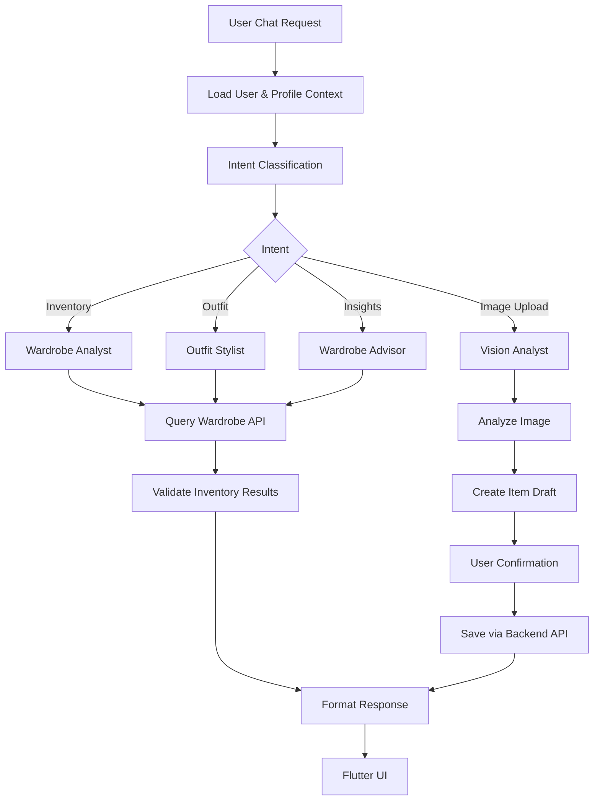

# Wardro AI — Family Wardrobe Intelligence Architecture

Now that I've seen the Wardro repository, I think there's a much more interesting opportunity here than building a generic chatbot.

**Wardro should become a personal wardrobe intelligence system for the entire family.**

A user should be able to ask:

- "What clothes do I have in my wardrobe?"
- "Show me all my black kurtis."
- "I have a blue jeans. What tops can I pair it with?"
- "What can I wear to office tomorrow?"
- "Suggest an outfit for my 5-year-old."
- "What clothes have I not worn in the last three months?"
- "Do I already have something similar to this dress?"
- "Create a matching outfit for me and my husband."
- "What should I pack for a 5-day trip?"

The AI should understand the actual inventory, not hallucinate clothes that the user doesn't own.

## Existing Wardro foundation

| Layer | Current implementation |
| --- | --- |
| Mobile | Flutter |
| Authentication | Firebase Auth |
| Backend | Bun + Hono |
| Database | PostgreSQL + Drizzle |
| Image storage | Firebase Storage |
| Website | Next.js |

Your backend already has user, wardrobe and wardrobe_item tables, with fields such as item name, photo, brand, category, color, size and purchase date. This is a good foundation. I would not rewrite the existing application.

Instead, introduce a separate Python AI service using LangGraph and Ollama.

## 1. What Wardro AI should look like

> [Image placeholder 1: Premium AI personal wardrobe assistant mobile app, clothing inventory and fashion catalog UI.]
> 

Think of Wardro AI as having four main capabilities.

### 1. Wardrobe intelligence

Understand what a user owns, categorize clothing and retrieve exact inventory.

### 2. Outfit intelligence

Match clothes, colors, accessories and occasions using existing wardrobe items.

> [Image placeholder 2: Fashion outfit styling flat lay with jeans, shirt, shoes and accessories.]
> 

### 3. Family wardrobe intelligence

Manage separate wardrobes for women, men, children and other household members.

> [Image placeholder 3: Coordinated family outfits.]
> 

### 4. Smart wardrobe insights

Track usage, identify unused clothing, plan purchases and avoid duplicates.

> [Image placeholder 4: Seasonal capsule wardrobe and closet organization.]
> 

**Important product decision:** Don't create separate AI agents for mom, wife, girl, kid and men. Create one intelligent wardrobe engine that understands different wardrobe profiles and their preferences.

Example household structure:

```
Household
  |
  |-- Adult 1
  |     |-- Sarees
  |     |-- Kurtis
  |     |-- Western wear
  |     |-- Footwear
  |
  |-- Adult 2
  |     |-- Shirts
  |     |-- Trousers
  |     |-- Casual wear
  |
  |-- Child 1
  |     |-- T-shirts
  |     |-- Shorts
  |     |-- School wear
  |
  |-- Child 2
        |-- Baby clothes
        |-- Rompers
        |-- Traditional wear
```

These are separate wardrobe profiles, not separate AI systems. Each profile has its own inventory, preferences, size information and history.

## 2. Recommended architecture for Wardro

> [Architecture image placeholder: Flutter app → Bun + Hono backend → FastAPI AI service with LangGraph harness → Ollama, PostgreSQL and Firebase.]
> 

Think of the architecture as:

- **Wardro Flutter App:** Chat, add clothes, upload photos, display outfit cards.
- **Existing Bun + Hono Backend:** Firebase authentication, user authorization and existing APIs.
- **New Python AI Service — FastAPI:** Intent router, wardrobe agent, stylist agent, vision agent and LangGraph harness.
- **Ollama:** Local text and vision models.
- **PostgreSQL:** Inventory and related records.
- **Firebase Storage:** Clothing photos.

### Why a separate Python service?

Your existing Bun backend already manages authentication, database operations and storage. Let it continue doing that.

The Python service should handle AI reasoning, image analysis and recommendations.

Recommended interaction:

1. Flutter sends a chat request to Bun.
2. Bun validates the Firebase ID token.
3. Bun forwards the authenticated user context to Python.
4. Python runs the LangGraph workflow.
5. The agent retrieves wardrobe data through authorized backend APIs.
6. Python returns structured results.
7. Flutter displays clothes and outfit cards using existing photo URLs.

This avoids duplicating your existing Drizzle database logic in Python.

## 3. The agents and their responsibilities

Start with four logical agents, implemented as nodes in one LangGraph workflow.

| Agent | Responsibility | Example |
| --- | --- | --- |
| Wardrobe Analyst | Understand inventory | Find all black kurtis |
| Outfit Stylist | Match clothes | Suggest tops for blue jeans |
| Vision Analyst | Understand uploaded photos | Identify a kurti from a photo |
| Wardrobe Advisor | Analyze usage and gaps | Find clothes not worn recently |

You don't need four independent LLM processes. Initially, each can be a node with a specific prompt, tools and structured output. This reduces latency and resource usage with local Ollama models.

### Agent workflow



Inventory retrieval should be deterministic. Don't ask an LLM to remember which clothes the user owns; query the database.

## 4. Build the wardrobe intelligence data model

Your current `wardrobe_item` schema is a good start, but fashion recommendations need richer attributes.

For example, simply knowing that an item is a `top` and its color is `blue` isn't sufficient to suggest good outfits.

Useful attributes:

- Clothing type: Kurti, shirt, jeans, saree, dress.
- Pattern: Floral, striped, plain, checks.
- Material: Cotton, silk, denim, linen.
- Occasion: Office, casual, party, wedding.
- Season: Summer, winter, monsoon.
- Fit: Regular, slim, oversized.
- Sleeve: Sleeveless, half, three-quarter, full.
- Style: Traditional, western, ethnic fusion.

### Suggested database additions

| Table | Purpose |
| --- | --- |
| `wardrobe_profile` | Separate family members |
| `wardrobe_item_analysis` | AI-extracted clothing attributes |
| `outfit` | Saved outfit combinations |
| `outfit_item` | Items associated with an outfit |
| `wear_history` | Track when clothes are worn |
| `style_preferences` | User's preferred colors, styles and occasions |

Example `wardrobe_item_analysis` record:

```json
{
  "wardrobe_item_id": 125,
  "garment_type": "kurti",
  "category": "ethnic_wear",
  "primary_color": "mustard yellow",
  "secondary_colors": ["white"],
  "pattern": "floral",
  "material": "cotton",
  "sleeve_length": "three_quarter",
  "occasion": ["casual", "office"],
  "season": ["summer", "monsoon"],
  "confidence": 0.94,
  "verified_by_user": false
}
```

Store original user-entered attributes separately from AI predictions. AI should never silently overwrite user corrections.

A profile should represent a person, while a wardrobe represents a collection belonging to that person. This distinction becomes valuable when supporting an entire household.

## 5. Implement the Wardro Python service

Recommended project structure:

```
wardro-ai/
│
├── app/
│   ├── main.py
│   │
│   ├── api/
│   │   ├── chat.py
│   │   ├── wardrobe.py
│   │   └── images.py
│   │
│   ├── agents/
│   │   ├── wardrobe_analyst.py
│   │   ├── outfit_stylist.py
│   │   ├── vision_analyst.py
│   │   └── wardrobe_advisor.py
│   │
│   ├── graph/
│   │   ├── state.py
│   │   ├── workflow.py
│   │   ├── nodes.py
│   │   └── routing.py
│   │
│   ├── tools/
│   │   ├── wardrobe_tools.py
│   │   ├── outfit_tools.py
│   │   └── history_tools.py
│   │
│   ├── vision/
│   │   ├── image_analyzer.py
│   │   └── schemas.py
│   │
│   ├── services/
│   │   ├── backend_client.py
│   │   └── ollama_provider.py
│   │
│   ├── policies/
│   │   └── access_control.py
│   │
│   └── schemas/
│       ├── requests.py
│       └── responses.py
│
├── tests/
├── pyproject.toml
├── Dockerfile
└── .env
```

### Step 1: Install dependencies

```bash
uv init --package

uv add \
  fastapi \
  uvicorn \
  langgraph \
  langchain-core \
  langchain-ollama \
  ollama \
  pydantic \
  pydantic-settings \
  httpx \
  pillow

uv add --dev pytest pytest-asyncio ruff
```

### Step 2: Choose Ollama models

Wardro has two different AI requirements.

- **Text and reasoning model — Qwen3:** Intent classification, inventory queries, outfit reasoning and tool calls.
- **Vision model — Qwen2.5-VL / Qwen3-VL:** Clothing recognition, colors, patterns, garment type and image understanding.

Example setup (verify the model tags available in your Ollama installation):

```bash
ollama pull qwen3:8b
ollama pull qwen2.5vl:7b
```

Keep separate model configuration:

```
OLLAMA_BASE_URL=http://localhost:11434

TEXT_MODEL=qwen3:8b
VISION_MODEL=qwen2.5vl:7b

BACKEND_API_URL=http://localhost:3000/api
```

### Step 3: Define the LangGraph state

`app/graph/state.py`

```python
from typing import TypedDict, Annotated, Any
from langchain_core.messages import AnyMessage
from langgraph.graph.message import add_messages

class WardroState(TypedDict):

    messages: Annotated[list[AnyMessage], add_messages]

    user_id: str
    profile_id: str

    intent: str

    filters: dict[str, Any]

    wardrobe_items: list[dict]

    recommendations: list[dict]

    response: dict

    iteration: int
```

One conversation can contain multiple requests, but every request must carry the authenticated user's profile context.

### Step 4: Build the backend API adapter

`app/services/backend_client.py`

```python
import httpx

class WardrobeBackendClient:

    def __init__(self, base_url: str):
        self.base_url = base_url

    async def search_items(
        self,
        access_token: str,
        profile_id: str,
        filters: dict
    ):

        async with httpx.AsyncClient() as client:

            response = await client.get(
                f"{self.base_url}/wardrobe/items",
                headers={
                    "Authorization": f"Bearer {access_token}"
                },
                params={
                    "profileId": profile_id,
                    **filters
                },
                timeout=15
            )

            response.raise_for_status()

            return response.json()
```

The endpoint above is an integration contract to implement or map to your existing routes, not a claim that this exact route already exists.

The Bun backend must independently verify that the authenticated user owns the requested profile. Never trust a `user_id` or `profile_id` merely because an LLM supplied it.

### Step 5: Create wardrobe tools

`app/tools/wardrobe_tools.py`

```python
from langchain_core.tools import tool, ToolRuntime

def create_wardrobe_tools(backend):

    @tool
    async def search_wardrobe(
        filters: dict,
        runtime: ToolRuntime
    ) -> dict:
        """Search the authenticated user's wardrobe.

        Filters may include category, color, brand,
        pattern, occasion and clothing type.
        """

        context = runtime.context

        return await backend.search_items(
            access_token=context["access_token"],
            profile_id=context["profile_id"],
            filters=filters
        )

    return [search_wardrobe]
```

In this design, the authenticated context comes from the application runtime, not from the model-generated tool arguments. Define a LangGraph runtime context schema and supply it when invoking the graph.

### Step 6: Build the intent router

`app/graph/routing.py`

```python
from langchain_core.messages import SystemMessage

INTENT_PROMPT = """
Classify the user's wardrobe request.

Possible intents:
- inventory_search
- outfit_recommendation
- image_analysis
- wardrobe_insights
- general_chat

Return only the intent.
"""

async def classify_intent(state, model):

    result = await model.ainvoke([
        SystemMessage(content=INTENT_PROMPT),
        state["messages"][-1]
    ])

    intent = result.content.strip().lower()

    allowed = {
        "inventory_search",
        "outfit_recommendation",
        "image_analysis",
        "wardrobe_insights",
        "general_chat"
    }

    if intent not in allowed:
        intent = "general_chat"

    return {"intent": intent}
```

For production, use structured output with a Pydantic enum instead of relying on free-text classification.

### Step 7: Build the LangGraph workflow

```python
from langgraph.graph import StateGraph, START, END

from app.graph.state import WardroState

def build_wardro_graph(
    intent_node,
    wardrobe_node,
    stylist_node,
    vision_node,
    advisor_node,
    chat_node
):

    graph = StateGraph(WardroState)

    graph.add_node("intent", intent_node)
    graph.add_node("wardrobe", wardrobe_node)
    graph.add_node("stylist", stylist_node)
    graph.add_node("vision", vision_node)
    graph.add_node("advisor", advisor_node)
    graph.add_node("chat", chat_node)

    graph.add_edge(START, "intent")

    def route(state):
        return {
            "inventory_search": "wardrobe",
            "outfit_recommendation": "stylist",
            "image_analysis": "vision",
            "wardrobe_insights": "advisor",
            "general_chat": "chat"
        }.get(state["intent"], "chat")

    graph.add_conditional_edges("intent", route)

    for node in [
        "wardrobe",
        "stylist",
        "vision",
        "advisor",
        "chat"
    ]:
        graph.add_edge(node, END)

    return graph
```

This is the first Wardro-specific graph. Nodes can internally invoke tools or subgraphs as the implementation grows.

## 6. The most important feature: AI wardrobe image recognition

> [Image placeholder 5: Mustard yellow floral cotton kurti, isolated clothing product photograph, front view.]
> 

Imagine someone uploads a photo of a kurti. The AI should automatically identify:

- Garment: Kurti
- Primary color: Mustard yellow
- Secondary color: White
- Pattern: Floral
- Fabric: Cotton (estimated)
- Sleeve: Three-quarter
- Occasion: Casual / Office
- Style: Ethnic

It should then ask: "Looks like a mustard floral cotton kurti. Shall I add it to your wardrobe?"

Only after confirmation should it save the item.

### Implementation

`app/vision/schemas.py`

```python
from pydantic import BaseModel
from typing import Optional

class ClothingAnalysis(BaseModel):
    garment_type: str
    category: str
    primary_color: str
    secondary_colors: list[str] = []
    pattern: Optional[str] = None
    material: Optional[str] = None
    sleeve_length: Optional[str] = None
    occasion: list[str] = []
    season: list[str] = []
    confidence: float
```

`app/vision/image_analyzer.py`

```python
import json
import ollama

from app.vision.schemas import ClothingAnalysis

class WardrobeVisionAnalyzer:

    def __init__(self, model="qwen2.5vl:7b"):
        self.client = ollama.AsyncClient()
        self.model = model

    async def analyze(self, image_path):

        response = await self.client.chat(
            model=self.model,
            format=ClothingAnalysis.model_json_schema(),
            messages=[
                {
                    "role": "user",
                    "content": """
                    Analyze this clothing item.

                    Identify garment type, category,
                    primary and secondary colors,
                    pattern, fabric, sleeves,
                    occasions and seasons.

                    Do not invent details that cannot
                    be visually determined.

                    Use null for uncertain attributes.
                    """,
                    "images": [image_path]
                }
            ]
        )

        data = json.loads(response.message.content)

        return ClothingAnalysis.model_validate(data)
```

This is a starting implementation. Add image size limits, file-type validation, image preprocessing and confidence calibration before production. Fabric and season often cannot be reliably determined from an image alone, so those should be marked as estimates.

### Complete image ingestion lifecycle

1. **User uploads photo:** Flutter uploads to Firebase Storage.
2. **Vision analysis:** Python downloads the image using a controlled storage reference and analyzes it.
3. **Metadata extraction:** AI produces structured clothing attributes.
4. **Duplicate detection:** Search for similar existing wardrobe items.
5. **User confirmation:** User reviews and edits the detected details.
6. **Save:** Existing Bun API creates the wardrobe item and analysis record.

Eventually add duplicate detection using image embeddings. This will help answer "Do I already own something similar?"

## 7. How outfit recommendations should work

Suppose the user asks:

"I want to wear blue jeans tomorrow. Suggest something from my wardrobe for office."

The workflow should be:

1. Identify the selected profile.
2. Retrieve blue jeans.
3. Retrieve available tops, shirts and kurtis.
4. Filter items appropriate for office.
5. Generate possible combinations.
6. Score combinations using compatibility and preferences.
7. Ask the LLM to explain the best combinations.

> [Image placeholder 6: Three illustrative styling concepts — smart casual blue jeans with white shirt; blue jeans with pastel pink top; blue jeans with beige kurti. These are examples, not actual inventory results.]
> 

### Outfit scoring engine

Implement deterministic ranking before asking the LLM to explain the results.

```python
def score_outfit(
    color_match,
    occasion_match,
    style_match,
    user_preference,
    availability
):
    return (
        color_match * 0.30
        + occasion_match * 0.30
        + style_match * 0.15
        + user_preference * 0.15
        + availability * 0.10
    )
```

Improve this over time using user feedback:

- Like this outfit.
- Not my style.
- Already wore this recently.
- Prefer something traditional.
- Don't suggest this color combination.

The LLM handles natural language and styling explanations. Your ranking engine controls which real wardrobe combinations are recommended.

**Critical rule:** every recommended clothing item must reference a real `wardrobe_item.id`. The model must never invent inventory.

## 8. API design for Wardro AI

Expose these endpoints from the new Python service:

| Endpoint | Purpose |
| --- | --- |
| `POST /api/v1/chat` | General wardrobe conversation |
| `POST /api/v1/analyze-image` | Analyze uploaded clothing |
| `POST /api/v1/outfits/generate` | Generate outfit recommendations |
| `GET /api/v1/insights/{profile_id}` | Wardrobe insights |
| `GET /health` | Service health |

Example chat request:

```json
{
  "message": "Show me all black kurtis",
  "profile_id": "profile_123",
  "thread_id": "thread_456"
}
```

The profile ID must be validated against the authenticated user.

Example structured response:

```json
{
  "intent": "inventory_search",
  "message": "You have 4 black kurtis.",
  "items": [
    {
      "id": 125,
      "name": "Black floral kurti",
      "color": "Black",
      "category": "Ethnic wear",
      "image_url": "firebase-storage-image-url"
    }
  ],
  "suggestions": [
    "Show me black kurtis suitable for office",
    "Suggest outfits with these kurtis"
  ]
}
```

Flutter can render this as a chat message with actual wardrobe item cards.

## 9. Production considerations

| Concern | Implementation |
| --- | --- |
| Family privacy | Strict profile-level authorization |
| Image security | Private Firebase Storage and controlled access |
| Hallucinations | Database-backed inventory retrieval |
| Model latency | Cache results and use smaller models for classification |
| Image recognition | User confirmation and confidence thresholds |
| Memory | Persist conversations separately from wardrobe data |
| Scaling | Separate API workers from Ollama inference workers |
| Recovery | LangGraph PostgreSQL checkpoints |
| Monitoring | Trace model calls, graph nodes and tool execution |
| Cost | Local Ollama inference; monitor GPU/RAM usage |

One particularly important consideration: if you run Ollama on a local development machine, the Python service deployed in the cloud cannot automatically access it. For production, deploy Ollama on a secured GPU server or a dedicated inference service.

Also, don't send an entire household's wardrobe history to the model for every message. Retrieve only the relevant items.

## 10. What I would build first

Avoid implementing all four agents simultaneously.

### Wardro AI MVP — Milestone 1: Know my wardrobe

- Chat with wardrobe.
- Search by color, type, category and brand.
- Support separate family profiles.
- Return actual inventory cards.

### Milestone 2: Add clothes intelligently

- Upload a clothing photo.
- AI recognizes clothing.
- Auto-populate attributes.
- User confirms and saves.

### Milestone 3: My personal stylist

- Suggest outfit combinations.
- Occasion-based recommendations.
- Family outfit suggestions.
- Feedback-based personalization.

### Milestone 4: Wardrobe intelligence

- Unused clothes.
- Duplicate detection.
- Purchase suggestions.
- Seasonal wardrobe planning.

## 11. Three important product decisions

The initial decisions captured for this project are:

| Decision | Selected approach |
| --- | --- |
| User scope | Entire family with separate profiles |
| Clothing input | Both photo upload and mobile camera, with AI auto-categorization |
| Deployment | Local-first development, cloud deployment later |

### Recommended implementation direction

Start with family profiles, both photo upload methods, and local-first Ollama deployment. Build the inventory intelligence first. Once Wardro knows exactly what people own, the personal stylist becomes much more powerful.

The long-term differentiator isn't simply suggesting fashionable outfits. It's knowing **what each person already owns, what they actually wear, and how to make better use of it**.

---

## Transfer notes

This Notion page preserves the written architecture, code samples, JSON examples, tables and Mermaid workflow. The original response's generated inline images were rendered visuals rather than reusable image files or public URLs, so they are represented above as clearly labeled image placeholders. The Mermaid diagram is retained as Mermaid source and can be rendered by a Mermaid-compatible viewer or converted to a Notion visual separately.