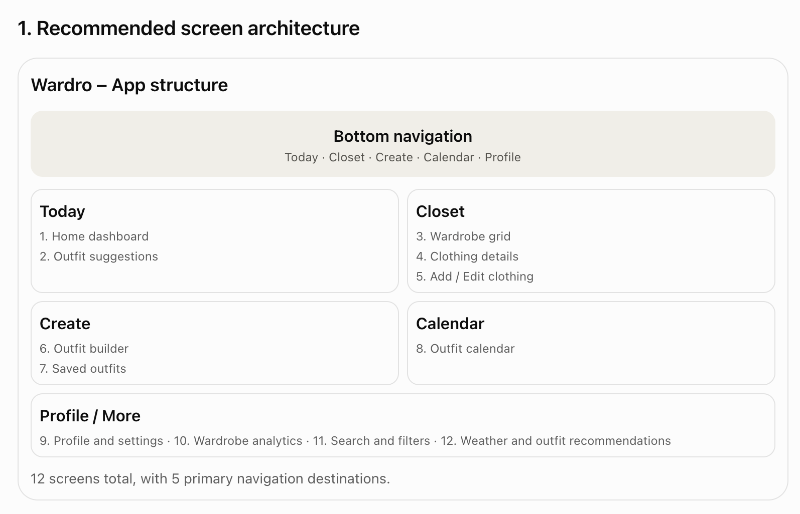

# Wardro — screen architecture

Status: **agreed 2026-11-05**. This is the target information architecture for
the React Native app. It supersedes the current `Home / Wardrobes / Items /
Profile` shell.

The visual direction, per-screen blueprints, component system, and reference
images live in [`design/`](design/README.md). The final five-destination
navigation is **Today · Closet · Create · Calendar · Profile**; the phases below
introduce those destinations only as their features ship.

> **Chat pilot (2026-11-05).** A fourth **Chat** tab now calls the local
> `wardro-agent` service and uses the active profile for context. It is a
> development pilot, not yet part of the final five-destination plan. The
> final placement of chat — and whether it absorbs Create/Calendar or remains a
> top-level destination — is an open decision after the wardrobe tools land.

## 1. Principles

- **Bottom tabs for primary navigation.** No hamburger drawer. Primary
  destinations stay visible and thumb-reachable.
- **3–5 destinations, all real.** Never ship an empty tab; add a destination
  when its feature exists.
- **One inventory.** “Closet” contains garments. Wardrobes are filters /
  collections inside it, not a second top-level inventory tab.
- **Adding clothing is a global action.** The camera FAB on Today/Closet is the
  primary add-clothing action; Add/Edit are flows, not destinations.
- **Create is a creation hub.** In the final navigation it is the prominent
  middle destination: the outfit builder is primary and “Add clothing” is a
  secondary entry. It must never be a vague “+” with no clear job.
- **Search and filters are tools, not screens.** They live in the Closet app
  bar and a filter sheet/chips.
- **Today carries daily value.** Planned outfit, weather, suggestions, recent
  items, and an insights preview.
- **Profile owns account and preferences.** Secondary items go in a clearly
  labelled “More” list; core actions are not buried there.
- **Consistent screen shells.** Pushed screens use `AppHeader` (44px back
  target, title, optional right action). Forms use `FormScreen` (fixed header,
  scrollable content, sticky action footer).
- **Profiles scope the wardrobe.** One account can hold multiple profiles
  (family members or contexts). Every wardrobe, item, outfit and plan belongs
  to exactly one profile; the active profile is explicit on Today. See
  [`multi-profile.md`](multi-profile.md).

## 2. Target navigation

Final state once outfits and planning exist:

**Today · Closet · Create · Calendar · Profile**

`Create` sits in the middle with a slightly more prominent treatment. Adding a
garment still has a direct camera action on Today/Closet, so it is never hidden
behind the Create tab.

Phased rollout:

| Phase | Tabs | Why |
| --- | --- | --- |
| **1 — Foundations** | Today · Closet · Profile + FAB | Ship only what exists; consolidate the current Home/Wardrobes/Items shell. |
| **1.5 — Profiles** | (same tabs) | One account, multiple profiles; active-profile switcher on Today; profile management in Profile. **Implemented.** |
| **2 — Create** | + Create | Add the middle creation tab when the outfit builder and saved-outfit library are real. Calendar starts as a `Library / Calendar` segment inside Create. |
| **3 — Calendar** | + Calendar | Promote outfit planning to its own tab once the calendar is substantial. |
| **4 — Intelligence** | (same tabs) | Weather, outfit suggestions, wear tracking, cost-per-wear and analytics appear as cards/screens on Today, Closet, and Profile. |

### Reference screen map

The reference map groups **12 screens across 5 destinations**. It is a useful
product map; the last column records where we intentionally place a screen
differently so “Profile / More” does not become a junk drawer.

| # | Reference screen | Destination in map | Wardro placement |
| --- | --- | --- | --- |
| 1 | Home dashboard | Today | Today |
| 2 | Outfit suggestions | Today | Today |
| 3 | Wardrobe grid | Closet | Closet |
| 4 | Clothing details | Closet | Closet |
| 5 | Add / Edit clothing | Closet | Closet (flow) |
| 6 | Outfit builder | Create | Create |
| 7 | Saved outfits | Create | Create |
| 8 | Outfit calendar | Calendar | Calendar (starts as a segment in Create) |
| 9 | Profile and settings | Profile / More | Profile |
| 10 | Wardrobe analytics | Profile / More | Today preview + full screen from Today/Profile |
| 11 | Search and filters | Profile / More | Closet tool (not a destination) |
| 12 | Weather and outfit recommendations | Profile / More | Today card + location setting under Settings |

### Why introduce five tabs gradually

- **Create needs a clear job.** Define it as the outfit builder + creation hub
  (outfit primary, add-clothing secondary). A generic “+” or an ambiguous
  “Create” label would confuse users.
- **Create and Calendar are two views of outfits.** Start with the calendar as
  a segment inside Create; promote it only when planning is substantial.
- **Search & filters, analytics, and weather are not “More” items.** Search is
  a Closet tool, analytics is reachable from Today and Profile (not a tab), and
  weather is a Today card with its location setting under Settings.
- **Empty tabs feel unfinished.** Create and Calendar do not exist yet, so
  Phase 1 launches with Today, Closet, and Profile.

## 3. Screen inventory

| Area | Screen | Purpose | Status |
| --- | --- | --- | --- |
| Today | **Today dashboard** | Greeting, summary, quick add, recent items, insights preview | Built |
| Today | **Profile switcher** | Horizontal avatars; switch the active profile, add a profile | Built |
| Today | Today’s outfit | The planned outfit for today | Later (Phase 2/3) |
| Today | Weather card | Small weather summary + relevant suggestion | Later (Phase 4) |
| Today | Outfit suggestions | Rule-based suggestions (weather + least-worn items) | Later (Phase 4) |
| Today | Insights preview | Value, item count, cost-per-wear; opens Analytics | Later (Phase 4) |
| Closet | **Closet grid** | Searchable, filterable garments with wardrobe chips | Merge current Items + Wardrobes |
| Closet | Search & filters | Text search + wardrobe/category/colour/size filters | Built (category chips appear when data has categories) |
| Closet | Item detail | Photo hero, details, dates, delete, edit, mark worn | Built; mark worn next |
| Closet | Add item | Photo-first capture | Built |
| Closet | Edit item | Pre-filled form + photo replacement | Built (photo replace picker) |
| Closet | Add / Edit wardrobe | Create or update a collection | Built |
| Closet | Wardrobe detail | One collection’s grid + delete + add | Built |
| Create | **Create hub** | Prominent middle destination: outfit builder primary, add clothing secondary | Later (Phase 2) |
| Create | Outfit builder | Compose an outfit from closet items on a large canvas | Later (Phase 2) |
| Create | Saved outfits | Two-column gallery, search/occasion filters, favourites | Later (Phase 2) |
| Create | Outfit detail | View/edit/plan an outfit | Later (Phase 2) |
| Calendar | Planner / calendar | Month or week view with outfit thumbnails by date | Later (Phase 3; starts as a segment in Create) |
| Profile | Profile | Identity, sign out | Built |
| Profile | Profiles | List/add/edit/delete profiles; active-profile context | Built |
| Profile | Add / Edit profile | Name, colour, delete (last profile protected) | Built |
| Profile | Settings | Units, notifications, weather location, privacy | Later |
| Profile | Wardrobe analytics | Full analytics view | Later (Phase 4) |
| Profile | Help / About | Support, version, legal | Later |

## 4. Navigation rules

- **FAB → Add item** from Today and Closet. Hidden on Create, Calendar, and
  Profile unless it gains a contextual create action.
- **Create** — opens the outfit builder; “Add clothing” is available as a
  secondary action. Keep the visual treatment slightly more prominent than the
  other tabs.
- **Closet header** — title, search, category/filter chips, and a “Manage
  wardrobes” entry. Add wardrobe lives here (and in Today quick actions).
- **Item detail** — back, edit, delete; later: mark worn, add to outfit.
- **Wardrobe detail** — back, edit, delete, add item; the count is the
  subtitle, description in the body.
- **Today** — the profile switcher sits directly under the greeting; the
  summary, recent items and wardrobes all belong to the active profile. Tap
  today’s outfit → detail; tap a suggestion → builder; quick actions for Create
  outfit / Add clothes.
- **Profile** — identity header, **Profiles** management, summary, analytics
  entry, preferences (weather location, notifications), settings, help/about,
  sign out. Keep “More” visually secondary to the account section.

## 5. Migration from the current implementation

Phase 1 is complete: the app ships **Today · Closet · Profile** (3 tabs), with
collections managed from a pushed Wardrobes screen. The separate 2026-11-05
Chat pilot adds a fourth **Chat** tab; it is intentionally outside the phased
plan until the final IA decision.

1. **Rename Home → Today.** ✅
2. **Merge Wardrobes + Items into Closet.** ✅
   - Closet = search + category/wardrobe chips + grid.
   - “Manage” opens the pushed Wardrobes screen; the separate tab is gone.
3. **Add Edit item / Edit wardrobe.** ✅ `PATCH` endpoints, pre-filled edit
   modes, photo replacement.
4. **Add multi-profile support.** ✅ See
   [`multi-profile.md`](multi-profile.md).
5. **Add Create** as the prominent middle tab when the builder exists; keep
   Calendar inside Create as a segment.
6. **Add Calendar** as a 5th tab when outfit planning is substantial.
7. **Add wear tracking + favourites.** These are the data foundation for
   analytics and suggestions; add “Mark worn” on item/outfit detail.
8. **Add weather + suggestions + analytics** as Today cards and a full
   Analytics screen.

Visual layouts, reusable components, and reference images for each step are in
[`design/`](design/README.md).

## 6. Current state

As of 2026-11-05:

- Firebase auth (email/password + Google), token-authenticated API client, and
  Firebase Storage photo uploads are in place.
- Shared `AppHeader` / `FormScreen` shells, back buttons, and sticky form
  footers are in place.
- Today dashboard with the profile rail, Closet with search/category/wardrobe
  filters, the pushed Wardrobes manager, item/wardrobe detail, add/edit item,
  add/edit wardrobe, and Profile with profile management are built.
- Multi-profile is implemented (household account, cascade delete) and the
  backend schema has been migrated.
- A **Chat** tab is wired to the local FastAPI/LangGraph agent. It sends the
  active profile and conversation thread; the agent still returns illustrative
  answers because wardrobe tools are not connected.
- The Today greeting uses the account's default profile name (Tiru) rather
  than the active profile, so switching to Swati/Arush/Adiran does not change
  the account greeting.
- Not built: outfits, calendar, favourites, wear tracking, analytics, weather,
  suggestions, chat auth proxy, real wardrobe tools and conversation
  persistence.

## 7. Open decisions

- **Chat placement:** the Chat tab is a pilot. Decide whether it stays a
  top-level destination, becomes the entry point to outfit creation, or is
  reached from Today's AI-stylist card. Do not finalise the five-tab map until
  the wardrobe tools make the answer concrete.
- **Profiles:** household account and cascade delete are implemented; profile
  photos, per-profile PINs and separate-account households remain future work.
  See [`multi-profile.md`](multi-profile.md).
- **Create hub composition:** outfit builder primary + add-clothing secondary;
  decide whether the tab opens the builder directly or a small create sheet.
- **Calendar placement:** start as a segment in Create; promote to a 5th tab
  once planning has enough depth and usage.
- **Analytics placement:** Today preview + a full screen reachable from Today
  and Profile; no dedicated tab.
- **Weather provider and location permission:** choose a provider and make
  location opt-in under Settings.
- **Suggestion rules:** start deterministic (weather + least-worn), then
  evaluate smarter recommendations later.
- **Wardrobe management entry:** a “Manage wardrobes” row in Closet vs a
  dedicated collection picker in the header. Prefer the row for discoverability
  with few collections.

## 8. Definition of done per phase

- **Phase 1:** one inventory tab, one daily dashboard, no empty destinations,
  every pushed screen has a back control and consistent spacing.
- **Phase 1.5:** an account can create and switch profiles; all data is scoped
  to the active profile; the default profile is created automatically; deleting
  a profile is explicit and never removes the last one. ✅
- **Phase 2:** an outfit can be created from real closet items, saved, viewed,
  edited, and deleted.
- **Phase 3:** outfits can be assigned to dates and viewed in a fashion-planner
  calendar.
- **Phase 4:** wear data drives cost-per-wear/analytics and a deterministic
  suggestion card on Today with an opt-in weather location.
